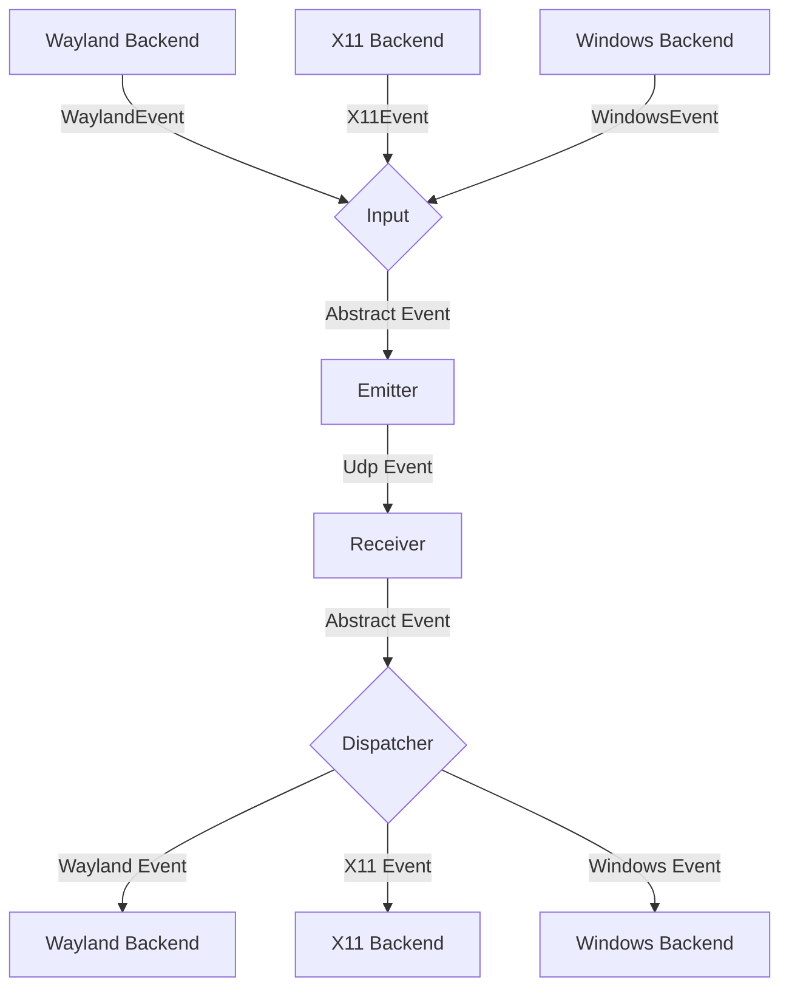
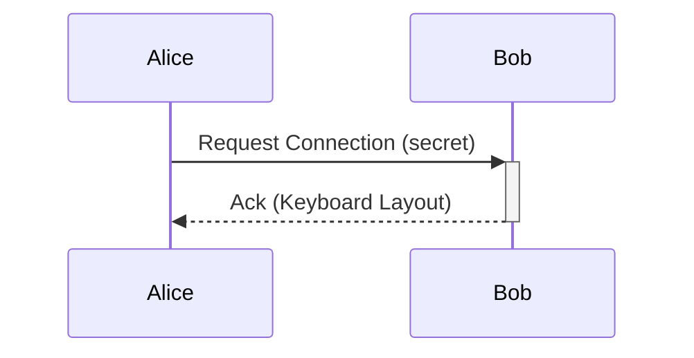

# General Software Architecture

## Events

Each instance of lan-mouse can emit and receive events, where
an event is either a mouse or keyboard event for now.

The general Architecture is shown in the following flow chart:

### Input
The input component is responsible for translating inputs from a given backend
to a standardized format and passing them to the event emitter.

### Emitter
The event emitter serializes events and sends them over the network
to the correct client.

### Receiver
The receiver receives events over the network and deserializes them into
the standardized event format.

### Dispatcher
The dispatcher component takes events from the event receiver and passes them
to the correct backend corresponding to the type of client.

## Requests

// TODO this currently works differently

Aside from events, requests can be sent via a simple protocol.
For this, a simple tcp server is listening on the same port as the udp
event receiver and accepts requests for connecting to a device or to
request the keymap of a device.

## Problems
The general Idea is to have a bidirectional connection by default, meaning
any connected device can not only receive events but also send events back.

This way when connecting e.g. a PC to a Laptop, either device can be used
to control the other.

It needs to be ensured, that whenever a device is controlled the controlled
device does not transmit the events back to the original sender.
Otherwise events are multiplied and either one of the instances crashes.

To keep the implementation of input backends simple this needs to be handled
on the server level.

## Device State - Active and Inactive
To solve this problem, each device can be in exactly two states:

Either events are sent or received.

This ensures that
- a) Events can never result in a feedback loop.
- b) As soon as a virtual input enters another client, lan-mouse will stop receiving events,
which ensures clients can only be controlled directly and not indirectly through other clients.

## Clipboard
The clipboard is a separate subsystem (crate `input-clipboard`). A snapshot is
a set of canonical formats (`text/plain;charset=utf-8`, `text/html`,
`image/png`) and is transferred over the existing DTLS association as its own
frame type (12–15) with chunking, acknowledgements and retransmission. The sync
layer suppresses echoes by content hash.

OS integration:
- GNOME 50+ / Wayland: `org.freedesktop.portal.Clipboard` (requires a one-time
  consent, persisted with a restore token).
- Windows: `CF_UNICODETEXT`, `CF_HTML`, `PNG`/`CF_DIB`.
- macOS: `NSPasteboard` (`public.utf8-plain-text`, `public.html`, `public.png`).
- wlroots/X11: not implemented yet.

## Windows capture internals

Pointer motion and barrier detection on Windows are driven by **raw input**
(`WM_INPUT`, relative mode), not by the cursor position reported to the low
level mouse hook:

- Windows clamps the cursor to the desktop, so `MSLLHOOKSTRUCT.pt` may never
  leave the monitor bounds. The old detector required such an out-of-bounds
  coordinate, which made edge hand-off depend on the OS build / DPI context
  (the Windows 10 to Windows 11 edge freeze). `outward_edge_crossing` instead
  checks "cursor is on the outermost desktop pixel **and** the raw delta points
  outward", which is clamp-agnostic.
- While a capture is active the raw delta is forwarded directly (converted to
  logical 96-DPI units by the entry monitor's scale). The hook's `pt` is not a
  per-event delta: it is an absolute clamped position, so using
  `pt - entry_point` froze the remote pointer once the local cursor hit the
  screen edge.
- The low level hook (`WH_MOUSE_LL`) still blocks input from local
  applications, forwards buttons/wheel, and performs `nCode < 0` handling. It
  never blocks on a full channel: Windows silently removes hooks that exceed
  `LowLevelHooksTimeout` (1 s since Windows 10 1709).
- The physical cursor is pinned to the entry point for the duration of the
  capture (re-pinned after every raw event), so it cannot drift into another
  monitor and the next hand-off starts from a known position.
- Input injected by lan-mouse itself is marked in
  `input_event::injection`; a barrier crossing within 120 ms of an injection is
  ignored, and the service sets a remote-active flag while a peer drives this
  machine. Together with the 350 ms post-release cooldown this prevents
  ping-pong at the shared border in bidirectional setups.
- The fallback path (raw input registration failed) keeps the old
  out-of-bounds detector and re-pins the cursor every event so its deltas are
  per-event rather than cumulative.

## Local cursor visibility

While a machine is driving a peer, its own pointer is hidden so the cursor
visually "moves" to the other screen instead of staying parked on the edge.

- **Windows**: a 1x1 topmost tool window (`WS_EX_TOPMOST | WS_EX_TOOLWINDOW |
  WS_EX_NOACTIVATE`) is created once, hidden, by the hook thread. On capture it
  is positioned under the pinned entry point, shown, and its `WM_SETCURSOR`
  handler calls `SetCursor(NULL)` and returns `TRUE`, which removes the pointer
  for as long as it stays over that window. On release the window is hidden;
  the next `WM_SETCURSOR` restores the normal cursor. A real window rather than
  `ShowCursor(FALSE)` is used because the display counter is global and an
  unbalanced call (crash, kill) can leave the cursor hidden system-wide, while
  the overlay is owned by the capture thread and disappears with the process.
- **macOS**: `CGDisplay::hide_cursor` / `show_cursor` around Grab/Release
  already.
- **Wayland wlroots/layer-shell**: the pointer cursor is set to `NULL` on
  grab; restoring it after release is compositor-dependent and should be
  validated on Sway/Hyprland. GNOME/Wayland (libei) has no API to hide the
  compositor-owned cursor, so it remains visible there.
- **X11**: the capture backend is not implemented in this fork.

The local cursor is only hidden on the *sending* side; the receiving machine
always keeps the visible pointer, since that is what the user is controlling.

## Symmetric roles
Every instance runs both a listener and an outgoing connection, so *server* and
*client* above only describe who initiates a given DTLS session — not a fixed
role. With a client entry on each side, either device can control the other.

The handoff is coordinated with a serial number: the side that captures sends
`Enter` with a monotonically increasing serial and retransmits it until the
peer answers with `Ack(serial)`. The receiver deduplicates retransmissions and
releases its own capture exactly once. `Leave` returns control.

## Multi-OS Testing Strategy
Testing combinations across Linux, Windows 10, and Windows 11 uses three layers:
1. **Cross-platform geometry & protocol tests (`cargo test --workspace`):**
   - `input-emulation/src/absolute.rs`: virtual desktop bounding box, clamping, `0..=65535` normalization, and DPI logical/physical conversion.
   - `input-capture/src/windows/display_util.rs`: multi-monitor barrier crossing and origin clamping, plus the clamped-cursor detector (`outward_edge_crossing`: cursor on the outermost pixel + raw delta pointing outward) used when Windows never reports a coordinate outside the monitor bounds.
   - `src/connect.rs`: full end-to-end loopback tests (`Capture` + `DummyInputCapture` → DTLS → `LanMouseListener` → `Emulation` + `ClipboardFrame`).
2. **Real Windows kernel & session CI (`.github/workflows/rust.yml` and `release.yml`):**
   - Runs on both `windows-2022` (Windows 10 / Server 2022 kernel) and `windows-2025` (Windows 11 24H2 / Server 2025 kernel) using MSYS2 `UCRT64`.
   - `tests/windows_input.rs` exercises real `SendInput`, `GetCursorPos`, `WH_MOUSE_LL`, and `WH_KEYBOARD_LL` hooks on the runner's desktop session, and checks that the local pointer is hidden while a capture is active and restored after release (`GetCursorInfo`).
   - `release.yml` runs a silent install (`/S`) of the NSIS installer, verifies `lan-mouse.exe doctor --probe --json` reports `windows` for both capture and emulation, and runs the silent uninstaller.
3. **Local KVM/QEMU lab (`scripts/vm-test-lab.sh`):**
   - Generates `quickemu`/QEMU configurations for Windows 10 and Windows 11 (with virtual TPM 2.0, Secure Boot, and QXL multi-head virtual monitors for mixed-DPI testing) plus pre-paired `config.toml` files using `trusted_ips`.

