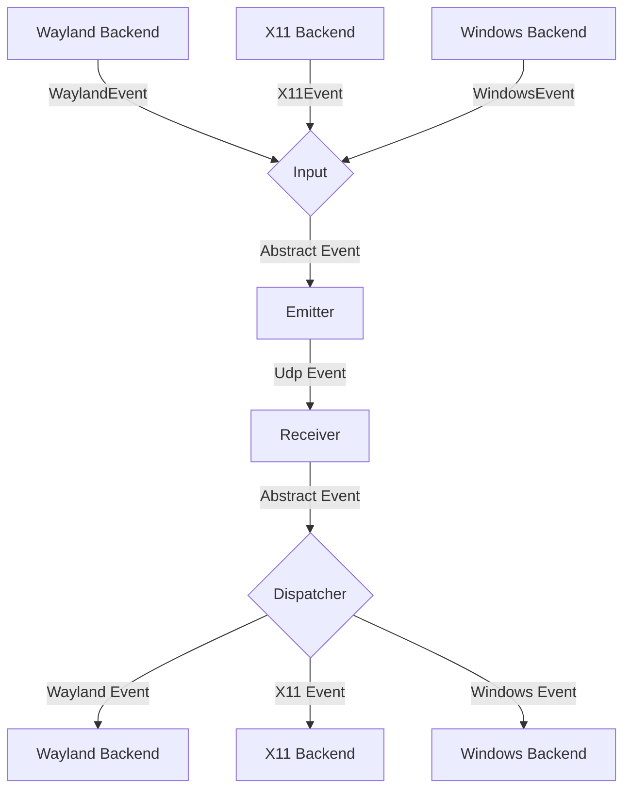

# General Software Architecture

## Events

Each instance of lan-mouse can emit and receive events, where
an event is either a mouse or keyboard event for now.

The general Architecture is shown in the following flow chart:

> **Note (this fork):** the X11 box in the input path is historical. X11 input
> *capture* is not implemented here (the backend is a stub that always returns
> NotImplemented); X11 only provides input *emulation* (the dispatcher path). An
> X11 session can receive input from peers but cannot send its own input to them.

### Input
The input component is responsible for translating inputs from a given backend
to a standardized format and passing them to the event emitter.

### Emitter
The event emitter serializes events and sends them over the network
to the correct client.

### Receiver
The receiver receives events over the network and deserializes them into
the standardized event format.

### Dispatcher
The dispatcher component takes events from the event receiver and passes them
to the correct backend corresponding to the type of client.

## Transport, Discovery and Authorization

The current implementation does **not** use the old TCP request channel that
earlier revisions of this document described. The actual flow is:

- **Discovery**: UDP port **4245**. Instances broadcast a small announcement
  and answer probes. This is only a convenience/scan mechanism: a beacon is
  unauthenticated and must never be treated as proof of identity.
- **Transport**: one or more **DTLS-over-UDP** associations on port **4242**.
  Each side presents a self-signed certificate; the peer identity is the
  SHA-256 certificate fingerprint. Connections are direct, peer-to-peer, with
  no relay or central server.
- **Incoming authorization**: the listener accepts a certificate only when its
  fingerprint is authorized (manual device, authorized key, an address rule, a
  pairing window, or an approved pending request). A certificate change is
  surfaced as a pending request with the previous fingerprint.
- **Identity learning (TOFU)**: an outgoing connection to an unpinned client
  learns and pins the peer certificate. Incoming control is still denied until
  the user authorizes the device.
- **Permissions**: once the extended handshake is understood, both sides send
  `AuthRequest`/`AuthResponse` with the capabilities granted in each direction;
  revocation uses `AuthRevoke`.
- **Liveness**: `Ping`/`Pong` provides RTT and detects a dead peer; a watchdog
  closes the transport and the reconnect loop backs off.
- **Edge hand-off extension**: peers advertising `EDGE_COORDINATE` may send
  `EnterAt { pos, serial, along }` with the normalised crossing coordinate
  (0.0 = top/left, 1.0 = bottom/right) so the receiver continues the pointer
  from the same point instead of jumping to the edge centre. The event id is
  additive and capability-gated: older peers keep receiving plain `Enter` and
  use the legacy fallback.

A beacon advertising a fingerprint is displayed as *unverified* until the
fingerprint is known locally, pinned by a handshake, or accepted by the user.

The frontend never speaks this protocol directly: it talks to the local service
over IPC (Unix socket on Linux, loopback TCP on Windows).

## Problems
The general Idea is to have a bidirectional connection by default, meaning
any connected device can not only receive events but also send events back.

This way when connecting e.g. a PC to a Laptop, either device can be used
to control the other.

It needs to be ensured, that whenever a device is controlled the controlled
device does not transmit the events back to the original sender.
Otherwise events are multiplied and either one of the instances crashes.

To keep the implementation of input backends simple this needs to be handled
on the server level.

## Device State - Active and Inactive
To solve this problem, each device can be in exactly two states:

Either events are sent or received.

This ensures that
- a) Events can never result in a feedback loop.
- b) As soon as a virtual input enters another client, lan-mouse will stop receiving events,
which ensures clients can only be controlled directly and not indirectly through other clients.

## Connection State Shown by the Frontend

The device card (GPUI: `lan-mouse-gpui/src/lib.rs`; legacy GTK:
`lan-mouse-gtk/src/client_row.rs`) derives its status badge,
spinner, action button and subtitle from the two link properties published by
the service:

- `active_addr`: an outgoing DTLS handshake completed (certificate verified or
  pinned). This is the only evidence of an outgoing link.
- `incoming_addr`: an incoming DTLS session was accepted; it does not prove the
  peer entered this screen or sends input.
- `alive`: the peer's "input emulation enabled" flag from its last `Pong`. It
  is also set optimistically after the handshake, so it is **not** a liveness
  signal and never triggers a "reconnecting" state.

Derived states: `Disconnected` (off, no incoming session), `Connecting…`
(enabled, no link yet; the subtitle only says "no answer yet" instead of
guessing firewall/DNS/approval), `Connected` (outgoing link; amber with
"emulation disabled on the other PC" when `alive` is false),
`Connected (bidirectional)` (both links) and `Peer connected` (incoming session
only; input is applied only after the peer enters this screen). The row offers
a single action per state (Connect / Cancel / Disconnect / Also connect).

Freshness of the last heartbeat (last `Pong`), explicit failure reasons and a
`remote_entered` flag need new optional fields in the IPC. The audit, the
remaining gaps and the recommended `ConnectionPhase` are documented in
[docs/client-connection-state.md](docs/client-connection-state.md).

## Clipboard
The clipboard is a separate subsystem (crate `input-clipboard`). A snapshot is
a set of canonical formats (`text/plain;charset=utf-8`, `text/html`,
`image/png`) and is transferred over the existing DTLS association as its own
frame type (12–15) with chunking, acknowledgements and retransmission. The sync
layer suppresses echoes by content hash.

OS integration:
- GNOME 50+ / Wayland: `org.freedesktop.portal.Clipboard` (requires a one-time
  consent, persisted with a restore token).
- Windows: `CF_UNICODETEXT`, `CF_HTML`, `PNG`/`CF_DIB`.
- wlroots: `wlr-data-control` (`input-clipboard/src/wayland.rs`).
- X11: `CLIPBOARD` selection (`input-clipboard/src/x11.rs`) with INCR support in
  both directions for large payloads; XFixes for reliable owner-change
  notifications when available (polling fallback otherwise).
- macOS (dormant, untested, unshipped): `NSPasteboard` with PNG and a
  TIFF-to-PNG fallback (`input-clipboard/src/macos.rs`).

## Windows capture internals

Pointer motion and barrier detection on Windows are driven by **raw input**
(`WM_INPUT`, relative mode), not by the cursor position reported to the low
level mouse hook:

- Windows clamps the cursor to the desktop, so `MSLLHOOKSTRUCT.pt` may never
  leave the monitor bounds. The old detector required such an out-of-bounds
  coordinate, which made edge hand-off depend on the OS build / DPI context
  (the Windows 10 to Windows 11 edge freeze). `outward_edge_crossing` instead
  checks "cursor is on the outermost desktop pixel **and** the raw delta points
  outward", which is clamp-agnostic.
- While a capture is active the raw delta is forwarded directly (converted to
  logical 96-DPI units by the entry monitor's scale). The hook's `pt` is not a
  per-event delta: it is an absolute clamped position, so using
  `pt - entry_point` froze the remote pointer once the local cursor hit the
  screen edge.
- The low level hook (`WH_MOUSE_LL`) still blocks input from local
  applications, forwards buttons/wheel, and performs `nCode < 0` handling. It
  never blocks on a full channel: Windows silently removes hooks that exceed
  `LowLevelHooksTimeout` (1 s since Windows 10 1709).
- The physical cursor is pinned to the entry point for the duration of the
  capture (re-pinned after every raw event), so it cannot drift into another
  monitor and the next hand-off starts from a known position.
- Input injected by lan-mouse itself is marked in
  `input_event::injection`; a barrier crossing within 120 ms of an injection is
  ignored, and the service sets a remote-active flag while a peer drives this
  machine. Together with the 350 ms post-release cooldown this prevents
  ping-pong at the shared border in bidirectional setups.
- The fallback path (raw input registration failed) keeps the old
  out-of-bounds detector and re-pins the cursor every event so its deltas are
  per-event rather than cumulative.

## Local cursor visibility

While a machine is driving a peer, its own pointer is hidden so the cursor
visually "moves" to the other screen instead of staying parked on the edge.

- **Windows**: a 1x1 topmost tool window (`WS_EX_TOPMOST | WS_EX_TOOLWINDOW |
  WS_EX_NOACTIVATE`) is created once, hidden, by the hook thread. On capture it
  is positioned under the pinned entry point, shown, and its `WM_SETCURSOR`
  handler calls `SetCursor(NULL)` and returns `TRUE`, which removes the pointer
  for as long as it stays over that window. On release the window is hidden;
  the next `WM_SETCURSOR` restores the normal cursor. A real window rather than
  `ShowCursor(FALSE)` is used because the display counter is global and an
  unbalanced call (crash, kill) can leave the cursor hidden system-wide, while
  the overlay is owned by the capture thread and disappears with the process.
- **Wayland wlroots/layer-shell**: the pointer cursor is set to `NULL` on
  grab; restoring it after release is compositor-dependent and should be
  validated on Sway/Hyprland. GNOME/Wayland (libei) has no API to hide the
  compositor-owned cursor, so it remains visible there.
- **X11**: the capture backend is not implemented in this fork.

The local cursor is only hidden on the *sending* side; the receiving machine
always keeps the visible pointer, since that is what the user is controlling.

## Symmetric roles
Every instance runs both a listener and an outgoing connection, so *server* and
*client* above only describe who initiates a given DTLS session — not a fixed
role. With a client entry on each side, either device can control the other.

The handoff is coordinated with a serial number: the side that captures sends
`Enter` with a monotonically increasing serial and retransmits it until the
peer answers with `Ack(serial)`. The receiver deduplicates retransmissions and
releases its own capture exactly once. `Leave` returns control.

## Persistent State and Clean Install

Everything Lan Mouse persists for one user lives in a directory literally
called `lan-mouse`; there is no database and no registry-based device state.
Clients, `[[devices]]` (per-direction policies and capabilities),
`[[address_rules]]`, `authorized_fingerprints` and `[[denied]]` are all inside
`config.toml`. Pending approval requests and the pairing window are in-memory
only and disappear on restart.

| OS | Config, identity and audit | Extra runtime state |
| --- | --- | --- |
| Linux | `${XDG_CONFIG_HOME:-~/.config}/lan-mouse/` (`config.toml`, `lan-mouse.pem`), `${XDG_STATE_HOME:-~/.local/state}/lan-mouse/` (`audit.jsonl`) | portal consent tokens in the state directory (`input-capture.token`, `remote-desktop.token`, `clipboard.token`), migrated from the legacy `${XDG_CACHE_HOME:-~/.cache}/lan-mouse/` |
| Windows | `%LOCALAPPDATA%\lan-mouse\` (`config.toml`, `lan-mouse.pem`, `audit.jsonl`) | installation itself: `%PROGRAMFILES64%\Lan Mouse`, shortcuts, `HKLM` keys, firewall rule `Lan Mouse` |

**Upgrade vs fresh install.** Package upgrades intentionally keep the user's
configuration. A *fresh* install must not resurrect devices from an older
build. Cleaning is **reversible by default**: the app-owned directories are
renamed to a sibling `lan-mouse.bak-<timestamp>` (atomic same-directory
rename), so the next start sees a pristine config while the old devices,
certificate and audit log are preserved in the backup and can be restored by
renaming it back. Permanent deletion requires an explicit `--purge` /
`/PURGEUSERDATA`.

- **Windows installer** (`installer/windows/lan-mouse-custom.nsi`): stops the
  GUI and the daemon it spawned (`taskkill /T /F`), detects leftovers in
  `%LOCALAPPDATA%\lan-mouse` / `%APPDATA%\lan-mouse` and asks before cleaning
  them (interactive default: move to `lan-mouse.bak-<yyyyMMdd-HHmmss>`).
  Silent installs clean by default; `/KEEPUSERDATA` preserves the
  configuration, `/CLEANUSERDATA` forces a clean install and
  `/PURGEUSERDATA` deletes the old data permanently instead of backing it up.
  The previous `$INSTDIR` is wiped before extraction so stale binaries cannot
  mix with the new build. The uninstaller moves the same user-data directories
  to a backup (silent: yes, `/KEEPUSERDATA` keeps them in place,
  `/PURGEUSERDATA` deletes them).
- **`lan-mouse --reset-config [--dry-run] [--purge]`** (`src/reset.rs`,
  handled in `src/config.rs` before `Config::new` creates anything): moves the
  config, state and legacy cache directories of the current user
  to timestamped `lan-mouse.bak-<unix timestamp>` siblings (`--purge` deletes
  them instead). It refuses to run while the service is running, only touches
  paths whose final component is exactly `lan-mouse`, does not follow symlinks,
  prints every path and never touches custom `--config` / `--cert-path`
  locations.
- **Linux `.deb`**: maintainer scripts never modify home directories (dpkg runs
  as root and cannot know which users ran the app). `postrm purge` prints the
  per-user paths and how to reset; `scripts/install-clean.sh`
  (`--dry-run`/`--yes`/`--purge`) is the scripted equivalent for Linux and
  also defaults to a reversible backup.

See [docs/audit-fresh-install.md](docs/audit-fresh-install.md) for the exact
path table, the fresh-install/upgrade/uninstall matrix and the remaining risks
(multi-user machines, elevated installs, custom paths, portal tokens, TCC).

## Multi-OS Testing Strategy
Testing combinations across Linux, Windows 10, and Windows 11 uses three layers:
1. **Cross-platform geometry & protocol tests (`cargo test --workspace`):**
   - `input-emulation/src/absolute.rs`: virtual desktop bounding box, clamping, `0..=65535` normalization, and DPI logical/physical conversion.
   - `input-capture/src/windows/display_util.rs`: multi-monitor barrier crossing and origin clamping, plus the clamped-cursor detector (`outward_edge_crossing`: cursor on the outermost pixel + raw delta pointing outward) used when Windows never reports a coordinate outside the monitor bounds.
   - `src/connect.rs`: full end-to-end loopback tests (`Capture` + `DummyInputCapture` → DTLS → `LanMouseListener` → `Emulation` + `ClipboardFrame`).
2. **Real Windows kernel & session CI (`.github/workflows/rust.yml` and `release.yml`):**
   - Runs on both `windows-2022` (Windows 10 / Server 2022 kernel) and `windows-2025` (Windows 11 24H2 / Server 2025 kernel) using MSYS2 `UCRT64`.
   - `tests/windows_input.rs` exercises real `SendInput`, `GetCursorPos`, `WH_MOUSE_LL`, and `WH_KEYBOARD_LL` hooks on the runner's desktop session, and checks that the local pointer is hidden while a capture is active and restored after release (`GetCursorInfo`).
   - `release.yml` runs the silent install (`/S`), the `lan-mouse.exe doctor --probe --json` probe and the silent uninstaller in separate steps, checks every exit code, uploads stdout/stderr plus the installer log as diagnostics, and publishes SHA-256 checksums for all artifacts.
3. **Local KVM/QEMU lab (`scripts/vm-test-lab.sh`):**
   - Generates `quickemu`/QEMU configurations for Windows 10 and Windows 11 (with virtual TPM 2.0, Secure Boot, and QXL multi-head virtual monitors for mixed-DPI testing) plus pre-paired `config.toml` files using `trusted_ips`.

